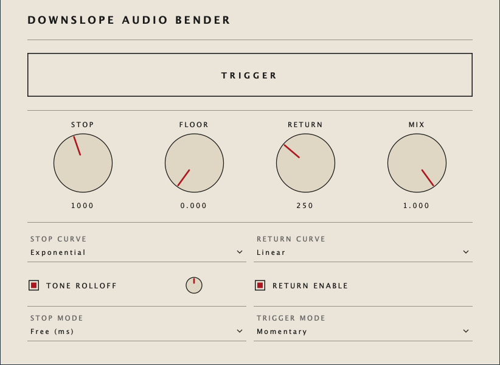

# Downslope

A tape-stop audio effect for macOS, built with JUCE. Ships as an Audio Unit, VST3, and a standalone GUI host.

Triggers can be drawn into Ableton's automation lane (or any DAW), MIDI-mapped to a controller, or pressed directly. The slowdown shape, length, floor pitch and tone behaviour are all parametric, and the stop time can be either free milliseconds or synced to host tempo (including triplets).



---

## What it does

Pressing **TRIGGER** behaves like dragging a finger on a tape reel: playback slows down to a configurable floor pitch over a configurable time, with a configurable curve. Releasing the trigger either ramps back up to normal speed, or — if Return is disabled — crossfades back to dry. In **One-Shot** trigger mode, a single rising edge fires the whole slowdown-then-return envelope without you needing to hold anything.

Two flavours of slowdown:

- **Stop Mode = Free (ms)**: the **STOP** and **RETURN** knobs read in milliseconds (10 ms – 8 s for stop; 5 ms – 4 s for return).
- **Stop Mode = Sync**: the same knobs become discrete steppers through musical divisions (1/16t … 4 bars including triplets and dotted values), derived from the host's BPM.

Other controls:

- **FLOOR**: how far the pitch falls. 0% = full stop (silence at the bottom of the ramp); 100% = no change.
- **MIX**: dry/wet blend.
- **STOP CURVE / RETURN CURVE**: linear, exponential (ease-in), logarithmic (ease-out), or S-curve.
- **TONE ROLLOFF + amount knob**: a one-pole low-pass that closes as the rate drops, emulating tape's high-frequency loss when slowing. The amount knob shapes the curve — noon is the "natural" relationship, left of noon darkens faster, right of noon keeps more highs.
- **RETURN ENABLE**: turn off to let the effect end in silence (or at the floor pitch) rather than ramping back up.

---

## Core design

The repo has two CMake targets sharing the same processor + editor code:

1. **`Downslope`** — the plugin, packaged as AU, VST3, and Standalone.
2. **`DownslopeHost`** — a small JUCE app for working on the effect outside a DAW. It opens an audio file, loops it, runs it through the same `DownslopeAudioProcessor`, and embeds the plugin's real editor.

### File map

```
Source/
  TapeStopEngine.h/.cpp     Pure-C++ DSP: ring buffer, state machine, interpolation
  PluginProcessor.h/.cpp    JUCE AudioProcessor: APVTS params, host glue
  PluginEditor.h/.cpp       Editor: layout, parameter attachments, mode-aware UI swaps
  MinimalistLookAndFeel.h   Custom JUCE LookAndFeel (travertine + Corbusier red)

HostApp/
  Main.cpp                  juce::JUCEApplication boilerplate
  MainComponent.h/.cpp      File player + transport + embedded plugin editor

tests/
  test_TapeStopEngine.cpp   Catch2 unit tests for the DSP
  test_render.cpp           End-to-end render characterization tests

Assets/icon.png             1024×1024 source icon (squircle, cream + red)
tools/make_icon.py          Regenerates Assets/icon.png from scratch
CMakeLists.txt              Three targets (plugin, host app, tests); JUCE + Catch2 via FetchContent
```

### How the DSP works

The engine is a variable-rate read from a 10-second ring buffer:

- **Write head** advances by 1 per sample, always recording the live input.
- **Read head** starts at the write head and advances by `rate`, where rate is driven by a state machine: 1.0 in Idle, ramping 1.0 → floor in Stopping, holding at floor in Holding, ramping floor → 1.0 in Returning, then settling back to dry.
- **Cubic interpolation** (Catmull-Rom) on the read keeps the slowdown smooth. The read head is positioned a few samples behind the write head on trigger onset so the interp's forward look-ahead doesn't read stale wrap-around data — this is what kills the click most tape-stop plugins produce at trigger.
- **Tone rolloff** is a one-pole low-pass whose coefficient shrinks as `rate` drops. The amount knob shapes the relationship via an exponent (`exp2(1 - amount*2)`), short-circuited when ~1.0 to skip the per-sample `std::pow`.
- **Amplitude envelope**: when `rate` falls below ~15% of nominal, output is faded to silence — otherwise reading the same sample over and over would produce DC.
- **DC blocker** (~5 Hz HP) on the wet path is cheap insurance against held DC at full stop.
- **Settling crossfade** (~30 ms) blends from the buffer-read tail back to the live dry signal when the envelope ends, so the time-warped audio can transition cleanly back to real-time.

All user-facing parameters are smoothed (one-pole, ~20 ms) so automation is zipper-free.

### Threading model

- `processBlock` runs on the audio thread. Parameters are read via cached `std::atomic<float>*` pointers (acquired once at construction, no per-block hash lookup).
- The editor polls a few parameters at 20 Hz on the message thread to drive enable/disable UI state — deliberately avoiding `APVTS::Listener`, which dispatches across threads in ways some hosts struggle with at shutdown.
- All APVTS attachments are torn down explicitly at the top of the editor's destructor so the editor never relies on the destructor-order race between editor and processor.

---

## Building

### Prerequisites

- macOS (CoreAudio + AU build paths assumed)
- Xcode + Command Line Tools, with `xcode-select` pointing at the full Xcode install:
  ```sh
  xcode-select -p
  # should print: /Applications/Xcode.app/Contents/Developer
  # if it prints CommandLineTools, run:
  sudo xcode-select -s /Applications/Xcode.app/Contents/Developer
  sudo xcodebuild -license accept
  ```
- CMake (3.22+): `brew install cmake`
- (Optional) Ninja for faster command-line builds: `brew install ninja`

JUCE 8 is fetched automatically by CMake — no manual checkout needed.

### Configure + build

```sh
cd /path/to/downslope
cmake -B build -G Xcode
cmake --build build --config Release
```

Or with Ninja:

```sh
cmake -B build -G Ninja -DCMAKE_BUILD_TYPE=Release
cmake --build build
```

The first configure downloads JUCE (~100 MB) and takes a few minutes. Subsequent builds are fast.

### What gets built / where

- `build/Downslope_artefacts/Release/AU/Downslope.component`
- `build/Downslope_artefacts/Release/VST3/Downslope.vst3`
- `build/Downslope_artefacts/Release/Standalone/Downslope.app` — the plugin wrapped in JUCE's standalone shell (takes live audio input, no file player)
- `build/DownslopeHost_artefacts/Release/Downslope Host.app` — the file-playing host

`COPY_PLUGIN_AFTER_BUILD` automatically installs the AU and VST3 to `~/Library/Audio/Plug-Ins/{Components,VST3}` on every build.

### Tests

The repo ships with a small Catch2 test suite covering the DSP engine. Two layers:

- **Layer 1 — unit tests** (`tests/test_TapeStopEngine.cpp`): curve shapes (endpoints, midpoints, monotonicity, clamping); state-machine transitions (Idle → Stopping → Holding/Returning/Settling → Idle); click safety at trigger onset (regression test for the cubic-interp lookahead fix); NaN/Inf input never propagates; output stays bounded across a full envelope; defensive guards survive prepare-before-process and bad sample rates.
- **Layer 2 — render characterization** (`tests/test_render.cpp`): drives the engine end-to-end with a sine through full envelopes and asserts on per-block RMS shape — `floor=0` reaches silence in Holding; the return ramp brings amplitude back up; `mix=0` is near-dry passthrough; different stop curves produce distinct envelope shapes.

Build & run:

```sh
cmake --build build --config Release --target DownslopeTests
ctest --test-dir build -C Release --output-on-failure
```

Expected: `17/17 tests pass` in well under a second. To disable the test target entirely (skips downloading Catch2), pass `-DDOWNSLOPE_BUILD_TESTS=OFF` to `cmake -B build`.

A note on macOS: the build automatically ad-hoc-codesigns the test executable in a CMake post-build step. macOS Sequoia kills unsigned local binaries with `SIGKILL`, which would otherwise break `catch_discover_tests` during the post-build enumeration phase.

#### Test bugs vs engine bugs

If a render-characterization test fails, suspect the test before the engine: the asymptotic mix smoother and the DC blocker mean that "exact" assertions usually need generous tolerances. Two of the four render tests needed their thresholds relaxed on first run for exactly this reason.

### Regenerating the icon

The icon is generated from a Python script. To tweak colours/shape and regenerate:

```sh
python3 -m venv .venv && .venv/bin/pip install Pillow
.venv/bin/python tools/make_icon.py
# Force CMake to re-run juceaide so the new PNG gets converted to Icon.icns:
touch CMakeLists.txt
cmake -B build -G Xcode
cmake --build build --config Release
```

---

## Using it

### In Ableton Live (or any DAW)

1. Build (above). The AU/VST3 are auto-installed to `~/Library/Audio/Plug-Ins/`.
2. In Live: **Preferences → Plug-Ins → Rescan**.
3. Browser → **Plug-Ins → Mine → Downslope**. Drag onto an audio track.
4. The **TRIGGER** parameter shows up in Live's automation lane — draw it as a 0→1 step where you want the slowdown, drop back to 0 to release (in Momentary mode), or just a brief blip (in One-Shot mode).
5. Any control can be MIDI-mapped via Live's MIDI map (Cmd-M).

### In the host app

```sh
open "build/DownslopeHost_artefacts/Release/Downslope Host.app"
```

- **Open File…**: load a wav/aif/flac/mp3/ogg.
- **Play**, **Loop**, **Audio Settings…** (lets you pick the output device, sample rate, buffer size — JUCE's standard selector).
- The plugin editor is embedded in the lower half. Click TRIGGER (or use Live-style automation by MIDI mapping).
- All state — last file, loop toggle, device settings, every plugin parameter — is persisted to `~/Library/Application Support/Mine/DownslopeHost/DownslopeHost.settings` and restored on next launch.

### Standalone plugin (`Downslope.app`)

Different from the host app: this is JUCE's auto-wrapped standalone version of the *plugin*. It takes live audio from your interface input — there's no file player. Use the host app for offline-style experimentation.

---

## Common pitfalls

- **Stale "Icon.icns" after editing `Assets/icon.png`**: JUCE's `juceaide` doesn't always notice the PNG changed. `touch CMakeLists.txt` then re-configure.
- **macOS Finder still showing old icon after a rebuild**: Finder caches aggressively. Either `open` the new `.app` once, or move it out of the build directory and back.
- **`COPY_PLUGIN_AFTER_BUILD` didn't copy**: usually means you built only the host target (`--target DownslopeHost`). Build the default target (`cmake --build build`) to trigger the plugin's post-build copy step.
- **Live's plugin browser shows two "Downslope" entries**: leftover from a previous `COMPANY_NAME` / `PLUGIN_MANUFACTURER_CODE`. Delete the old bundle from `~/Library/Audio/Plug-Ins/` and rescan.

---

## Acknowledgements

Built with [JUCE 8](https://juce.com). DSP cues from the standard "DJ tape stop" effect tradition. Editor design borrows freely from Mies van der Rohe (less is more, hairline rules) and Le Corbusier (single saturated accent on cream).
